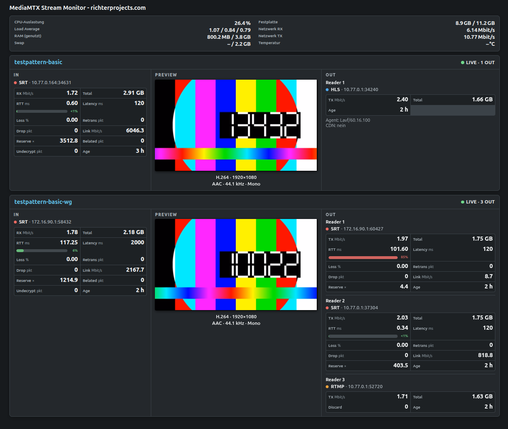

# MediaMTX Monitor

[](VERSION)
[](LICENSE)
[](docs/MEDIAMTX_V1_21_DATA.md)

MediaMTX Monitor zeigt aktive MediaMTX-Streams, Publisher, Reader, Bitraten,
SRT-Metriken und Systemdaten in einem kleinen Web-Dashboard. Das Frontend bleibt
Vanilla JavaScript. Redis puffert die vom Collector gelesenen Daten, FastAPI
liefert API und Dashboard aus.

Der Monitoringumfang ist bewusst protokollspezifisch: SRT besitzt derzeit die
tiefste Transport- und Ereignisauswertung; für RTMP/RTMPS und RTSP/RTSPS stellt
der Monitor jeweils andere passende MediaMTX-Metriken dar, weitere Protokolle
werden überwiegend generisch dargestellt. Fehlende MediaMTX-Metriken werden
nicht durch externe Messungen gegen Publisher oder Reader ersetzt. Details
stehen im [MediaMTX-v1.21+-Datenmodell](docs/MEDIAMTX_V1_21_DATA.md) und in der
[Architekturdokumentation](docs/ARCHITECTURE.md).

Der Monitor ist ein eigenständiges, schlankes Werkzeug ausschließlich für
MediaMTX. Er arbeitet strikt lesend, steuert keine Streams, kennt kein Failover
und enthält keine Integrationen für bestimmte andere Anwendungen. Die
dauerhaften [Leitlinien](docs/ARCHITECTURE.md#leitlinien) stehen in der
Architekturdokumentation.

> **Sicherheitshinweis:** Dashboard und Monitor-API besitzen keine eingebaute
> Authentifizierung und stellen auf Port 8080 unverschlüsseltes HTTP bereit.
> Dieser Port darf nicht ungeschützt aus dem öffentlichen Internet erreichbar
> sein. MediaMTX Monitor ist für die bewusste Integration durch Betreiber in
> eine von ihnen kontrollierte Server- und Netzwerkarchitektur vorgesehen,
> beispielsweise in ein internes LAN, ein Management-VLAN, ein separates
> WireGuard- beziehungsweise Managementnetz oder hinter einen Reverse Proxy mit
> HTTPS und bei Bedarf Authentifizierung. Firewall, Zugriffsschutz, TLS und
> öffentliche Erreichbarkeit liegen in der Verantwortung des Betreibers.

Der grundlegende Datenfluss ist:

```text
MediaMTX Control API → Collector → Redis → FastAPI → Browser
```

Der Collector aktualisiert den Stream-Snapshot standardmäßig ungefähr einmal
pro Sekunde. Der Browser ruft `GET /api/streams` regelmäßig per HTTP-Polling
ab; WebSockets werden nicht verwendet. Redis hält neben aktuellen Snapshots
kurzlebigen Messzustand und eine Kurzzeithistorie für Verbindungsmetriken.



Voraussetzung ist **MediaMTX v1.21.0 oder neuer**. Der Collector prüft die
laufende Version über `/v3/info` und meldet ältere oder nicht eindeutig
erkennbare Versionen als nicht unterstützt. Details zum erfassten Datenmodell
stehen in [docs/MEDIAMTX_V1_21_DATA.md](docs/MEDIAMTX_V1_21_DATA.md).

## Installation

Auf einem neuen Debian-, Ubuntu- oder Raspberry-Pi-OS-Server vom leeren
Benutzerverzeichnis bis zum laufenden Dashboard:

```bash
cd ~
git clone https://github.com/richtertoralf/mediamtxMonitor.git
cd mediamtxMonitor
sudo ./install.sh
```

Einzige Voraussetzung ist `git`, das auch `mediamtx-monitor --upgrade`
benötigt; falls es fehlt, mit `sudo apt install git` nachinstallieren. Alle
übrigen Pakete richtet `install.sh` selbst ein. Ist bereits eine vollständige
MediaMTX-Installation vorhanden, prüft der Installer sie nur und verändert sie
nicht; andernfalls richtet er MediaMTX zusammen mit dem Monitor ein.

Nach der Installation prüfen, ob beide Komponenten laufen und welche Versionen
installiert sind:

```bash
mediamtx --version
mediamtx-monitor --version
```

Anschließend das Dashboard unter `http://<server-ip>:8080/` öffnen.
Unterstützte Systeme und Architekturen, die Wiederverwendung vorhandener
MediaMTX-Installationen, Endpoints, Pfade, Dienste und Ports beschreibt
[Installation und Betrieb](docs/INSTALLATION.md).

## Kurzer Funktionstest

```bash
systemctl is-active mediamtx mediamtx-api mediamtx-collector mediamtx-system
curl -fsS http://127.0.0.1:9997/v3/info | python3 -m json.tool
curl -fsS http://127.0.0.1:9997/v3/paths/list | python3 -m json.tool
curl -fsS http://127.0.0.1:8080/api/streams | python3 -m json.tool
```

Dashboard: `http://<server-ip>:8080/`

## Verwaltung

| Befehl | Zweck |
|---|---|
| `mediamtx-monitor --version` | installierte Monitor-Version mit Commit |
| `mediamtx-monitor --status` | Dienste, Datenalter, Erreichbarkeit von MediaMTX und Redis, Dashboard-URLs; ohne sudo |
| `mediamtx-monitor --check-config [DATEI]` | Konfiguration prüfen und wirksame Werte mit Herkunft anzeigen |
| `sudo mediamtx-monitor --upgrade` | Monitor auf den aktuellen Stand von `main` aktualisieren; gleicher Stand ändert nichts |
| `sudo ./uninstall.sh` | Monitor entfernen; MediaMTX und seine Konfiguration bleiben |

MediaMTX selbst wird getrennt mit `sudo mediamtx --upgrade` aktualisiert; der
Monitor verändert weder MediaMTX noch dessen Konfiguration. Die lokale
`config/collector.yaml` gehört dem Betreiber und bleibt bei Upgrades erhalten.
Details: [Version und Upgrade](docs/INSTALLATION.md#version-und-upgrade),
[Betriebsstatus](docs/INSTALLATION.md#betriebsstatus-anzeigen),
[Konfiguration prüfen](docs/INSTALLATION.md#konfiguration-prüfen).

## Entwicklung und Tests

Die wichtigsten Bereiche des Repositories sind:

| Pfad | Inhalt |
|---|---|
| `bin/` | Collector, API, Systemerfassung und Backend-Hilfsmodule |
| `static/` | Vanilla-JavaScript-Dashboard und CSS |
| `config/` | Laufzeitkonfiguration und Installationsausschnitt für Preview |
| `systemd/` | Units für MediaMTX und die Monitoring-Dienste |
| `tests/` | Python-Unit-Tests und JavaScript-Renderer-Test |
| `devtools/` | kontrolliertes Deployment in die Entwicklungsinstallation |

Gemeinsamer lokaler Prüfpfad:

```bash
./devtools/verify.sh
```

## Dokumentation

- [Installation und Betrieb](docs/INSTALLATION.md)
- [Architektur und schrittweises Zielbild](docs/ARCHITECTURE.md)
- [Coding- und Dokumentationsstandard](docs/CODING_STYLE.md)
- [MediaMTX-v1.21+-Datenmodell](docs/MEDIAMTX_V1_21_DATA.md)
- [Betrieb und Troubleshooting](docs/TROUBLESHOOTING.md)
- [Entwicklungs-Deployment](devtools/README.md)

## Mitmachen

Fehler, Wünsche und Erfahrungen aus dem Betrieb bitte als
[Issue auf GitHub](https://github.com/richtertoralf/mediamtxMonitor/issues) melden.
Für Code gelten der [Coding- und Dokumentationsstandard](docs/CODING_STYLE.md) und
der gemeinsame Prüfpfad `./devtools/verify.sh`.

## Lizenz

MediaMTX Monitor steht unter der [MIT-Lizenz](LICENSE).

## RICHTER.PROJECTS

**Möglichkeiten schaffen.** MediaMTX Monitor gehört zu RICHTER.PROJECTS. Wer
Livestreams mit MediaMTX betreibt, sieht damit auf einen Blick, welche Streams
laufen, wer sendet und empfängt und wie es um Bitraten und SRT-Verbindungen
steht – mit einem schlanken Werkzeug, das ausschließlich liest und den
Streamingbetrieb nicht beeinflusst.
